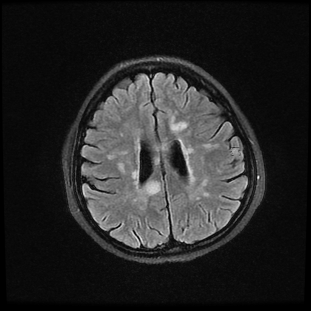
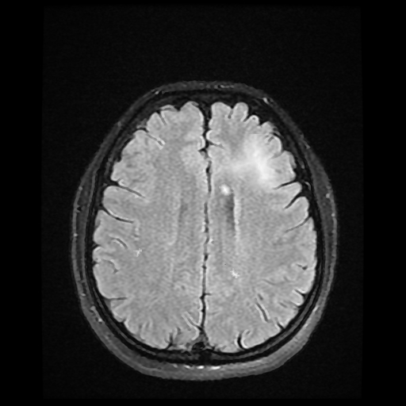
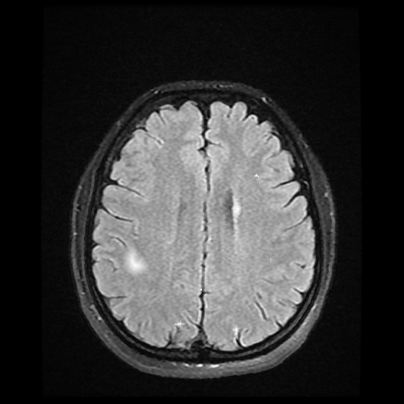
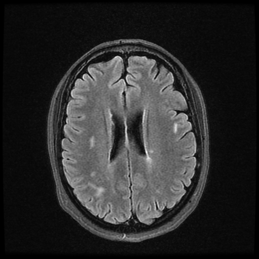

# Stage 3 — Synthetic Data Generation

`generate_synthetic_data.py` is the core contribution of the project: a
pipeline that extracts real plaques, deforms them, and composites them onto
MRI backgrounds to produce new, realistic (image, mask) training pairs.

Steps (see the module docstring and the report, section 7, for more detail):

1. Compute the per-image plaque-count distribution from the real masks.
2. Build a smoothed heatmap of plaque centroid locations.
3. Extract every real plaque, applying a randomized Bezier-curve radial
   deformation to each one so the same source plaque can be reused without
   looking identical every time.
4. For each synthetic image: sample a plaque count, then for each plaque —
   rotate/scale it randomly, apply an elastic deformation, make its mask
   edge irregular, pick a placement location guided by the heatmap
   restricted to the brain mask, and blend it in with a soft
   (Gaussian-feathered) alpha mask.

Example outputs from the report, one per transformation
(`../docs/assets/synthetic_example_*.png`):

| Translation | Scaling | Rotation | Shape changing |
|---|---|---|---|
|  |  |  |  |

This was originally developed and iterated on in Colab notebooks (kept
in the working folder, not copied into this cleaned-up repo since they're
a messy trial-and-error history rather than a finished artifact — this
`.py` file is the final, complete version of that pipeline). Edit the path
constants near the top of the file before running.

**Bug fixed during cleanup:** the original code called `elastic_transform`
separately on a plaque's image crop and on its mask, each with its own
unseeded random displacement field. That means the image warp and the mask
warp used *different* random fields, so a deformed plaque's texture and its
mask boundary could end up misaligned. This version generates one
displacement field per plaque (`elastic_displacement_field`) and applies it
to both the image and the mask, so they stay in sync. This changes the
exact pixel output vs. the original script (worth knowing if you're trying
to reproduce report figures exactly), but it's the correct behavior.
