# MS Lesion Segmentation — Synthetic Data Augmentation

Bachelor's project, Kharazmi University, Faculty of Mathematical Sciences
and Computer Science (Spring 2025). This README is an English adaptation
of the full report; the original (Persian) is at [`docs/MSProject.pdf`](docs/MSProject.pdf).

## Abstract

This report describes a research project aimed at improving the
performance of deep learning models in diagnosing Multiple Sclerosis (MS)
plaques in MRI images. The main challenge in this field is the lack of
sufficient labeled data to train accurate models. To address this, an
advanced synthetic data generation (data augmentation) method was
developed that creates new samples — with diverse shape, size and location
— from existing plaques. The method has three main stages: first, precise
analysis of existing plaque characteristics and extraction of the brain
region; second, development of a pipeline for plaque deformation and
synthetic data generation that uses Bezier curves and heatmaps for
realistic placement; and third, training and evaluating a model to show
the accuracy improvement gained from the generated data. Results show that
adding the synthetic data to the original dataset significantly improves
the model's performance at detecting plaques.

## 1. Introduction

Multiple Sclerosis (MS) is an autoimmune disease that affects the central
nervous system. Diagnosis is usually based on examining brain MRI images —
especially T1-weighted and FLAIR images — by radiologists. However, given
the large volume of images and the small size of the plaques (lesions)
within them, accurate and fast diagnosis is challenging. Today, deep
learning segmentation models have become a powerful tool for automatically
segmenting these plaques. Despite the high potential of these models,
achieving the desired performance requires large and precisely labeled
datasets. In medical imaging, collecting such data is costly and
time-consuming, and is often accompanied by ethical constraints. This data
scarcity causes models to perform poorly when they encounter new data. The
present project aims to overcome this challenge by developing an
innovative synthetic data generation method.

## 2. Project Data

Data from 250 patients was collected, each with roughly 25 depth slices of
their brain shown in MRI images. Some of these images contain plaques;
some of those plaques are **active** and some **inactive**. Active plaques
are the agent of the MS disease; inactive plaques pose no danger to the
patient.

### 2.1 MRI Images Weighted with T1 and FLAIR

In MRI imaging, different sequences are used to produce images with
different tissue contrasts. Here we describe the two main sequence types
used to examine MS plaques: T1-weighted and FLAIR images.

**2.1.1 T1-weighted (T1) images**

T1 images are usually created using short repetition time (TR) and echo
time (TE), which causes tissues with a short T1 relaxation time to appear
brighter.

- **Main contrast:** in T1 images, fat appears bright (white), and fluids
  (such as cerebrospinal fluid, CSF) appear dark (black).
- **After injection:** after gadolinium injection, inactive plaques become
  invisible in the images, while active plaques appear bright and clear.
- **Brain tissue appearance:** white matter is usually brighter than gray
  matter.
- **Clinical use:** this sequence is useful for precise examination of
  brain anatomy, and for diagnosing tumors and lesions that become active
  (enhance) with contrast material such as gadolinium.

**2.1.2 FLAIR (Fluid-Attenuated Inversion Recovery) images**

FLAIR is a specialized MRI technique particularly useful for detecting
abnormalities in the brain and spine. Its key feature is its ability to
suppress the fluid signal, achieved using an inversion pulse together with
long TR and TE times, which suppresses the cerebrospinal fluid signal.

- **Main contrast:** unlike T2 images (where fluids appear bright), in
  FLAIR images the CSF appears dark. This feature helps better
  distinguish lesions from the surrounding fluid.
- **Brain tissue appearance:** MS plaques and inflamed regions, due to
  their high water content, appear strongly bright (**hyperintense**),
  making them easily distinguishable against the dark CSF background.
- **Clinical use:** because of its high sensitivity to white-matter
  lesions, this sequence is the main tool for diagnosing and monitoring
  MS.
- **This project's data is of the FLAIR type.**

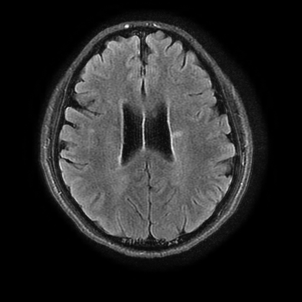

## 3. Project Goal

The ultimate goal of this project is to use artificial intelligence to
eliminate the need for gadolinium injection into the brain, because of its
numerous short- and long-term side effects for the patient, and because of
the high cost of this injection for both the patient and the hospital.
This (parent) project has 4 phases; this report covers its 4th phase.

## 4. Stage 1: Brain Region Extraction

Before any processing on the plaques, it is necessary to separate the main
brain region from other tissues and surrounding areas such as the skull,
scalp and eyes. This process, known as **Brain Extraction** or
**Brain Masking**, greatly increases the accuracy of subsequent steps. A
multi-stage approach was used for this purpose:

1. **Initial masking with thresholding** — initially, using a simple
   thresholding technique, an initial mask was created for the brain
   region. This method is fast, but has low accuracy and often includes
   non-brain regions, or mistakenly excludes parts of the brain.
2. **Manual correction with a GUI** — to fix the defects of the initial
   masks, a simple graphical user interface was designed to allow manual,
   precise correction of the mask boundaries.
3. **Model training** — a U-Net model was trained with the goal of
   automatically learning the brain boundaries.
4. **Correction and retraining** — after the initial training, the
   model's output was corrected by hand again. This stage created a cycle
   of improvement that led to a refined brain-extraction model.

Code: [`01_brain_extraction/`](01_brain_extraction).

| Good case | Failure case (lower slice, eyes visible) |
|---|---|
| 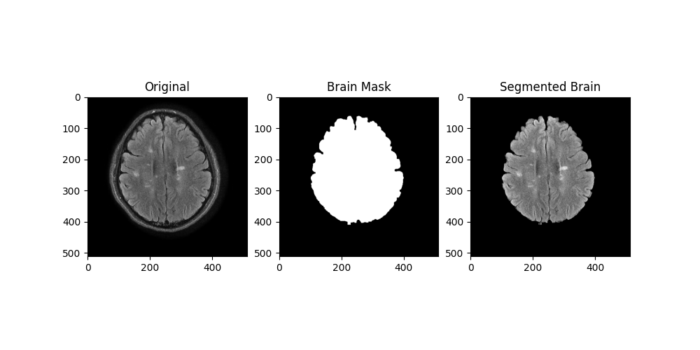 | 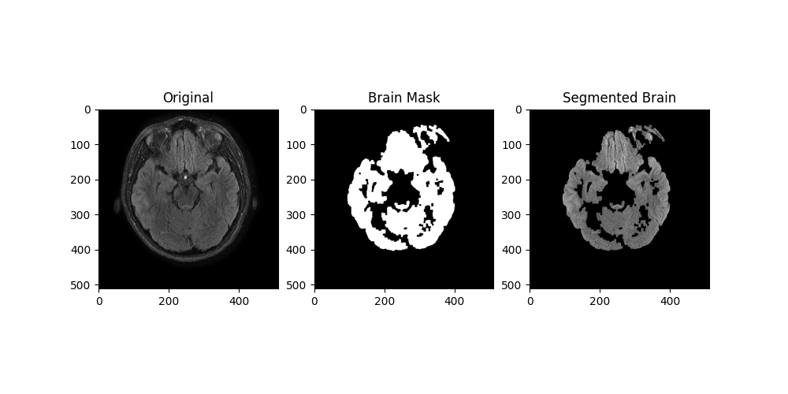 |

Two more examples of the threshold-based stage:
[`brain_extraction_example_2.png`](docs/assets/brain_extraction_example_2.png),
[`brain_extraction_example_3.png`](docs/assets/brain_extraction_example_3.png).
An example mask produced by the trained model:

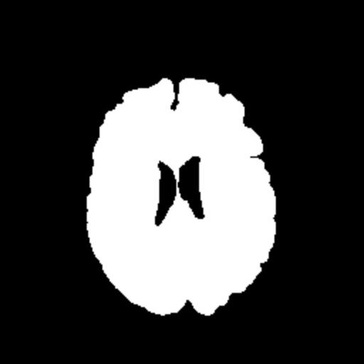

## 5. Stage 2: Analysis and Feature Extraction of Plaques

This stage deals with a precise, systematic analysis of the existing data.
The goal is to extract key features of the MS plaques to reach a deeper
understanding of their characteristics. This knowledge is the main basis
for generating realistic synthetic data in the next stage. The analysis
has three parts: statistical analysis, spatial analysis, and texture
feature extraction.

Code: [`02_plaque_analysis/`](02_plaque_analysis).

### 5.1 Statistical and Spatial Analysis of Plaques

Plaque masks were used to extract quantitative and spatial data.

- **Plaque count distribution** — by counting the number of plaques in
  each image, a precise statistical analysis was performed. The mean
  number of plaques per image was 4.37, with a standard deviation of 2.99.
  A skewness coefficient of 2.60 shows a positively asymmetric
  distribution — meaning most images have few plaques, while a limited
  number of them contain many.
- **Spatial distribution** — to understand the pattern of plaque
  placement, the centroid coordinates of each plaque were used. A
  Gaussian Mixture Model with 6 components was used to identify clusters.
  This analysis lets us identify specific brain regions where plaques
  occur more frequently. Finally, a **heatmap** was built as a 2D
  histogram of the plaque distribution, giving a precise visual
  description of where plaques concentrate.

| Plaque count histogram | GMM spatial clusters |
|---|---|
| 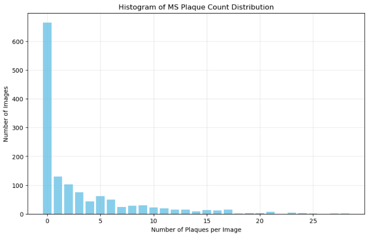 | 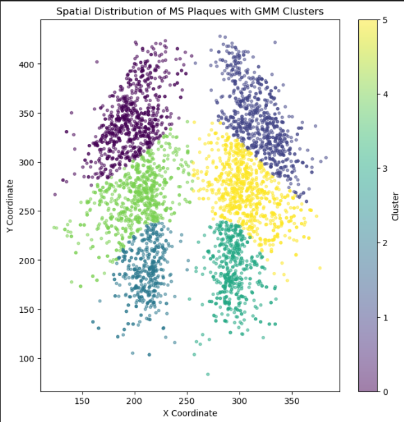 |

The continuous, Gaussian-smoothed probability map actually used to guide
synthetic plaque placement in Stage 3 looks like this:

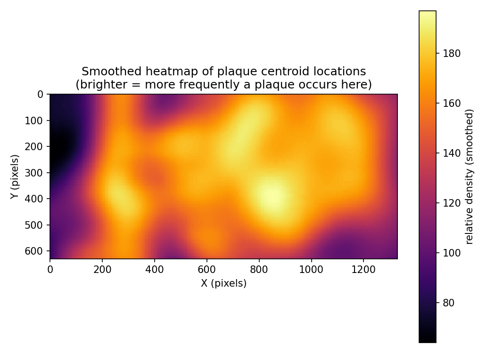

### 5.2 Texture Feature Extraction

To better understand the internal texture of plaques and distinguish them
from surrounding brain tissue, various features were extracted from the
pixels inside each plaque.

- **Intensity** — the mean and standard deviation of each plaque's
  brightness were measured as basic metrics. The skewness of the
  brightness was also calculated for each plaque.
- **Texture features (GLCM)** — to examine the textural detail of
  plaques, the Gray-Level Co-occurrence Matrix (GLCM) method was used.
  Four key features were extracted:
  1. **Contrast** — a measure of local differences in brightness,
     indicating the clarity of the plaque's edges.
  2. **Homogeneity** — shows the degree of uniformity of the plaque's
     texture; higher values indicate more uniform textures.
  3. **Energy** — shows the compactness and uniformity of the texture;
     higher values indicate more compact, uniform textures.
  4. **Correlation** — shows the degree of linear correlation between
     pixels.

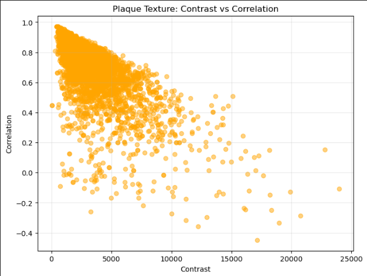

## 6. Stage 3: Generation of Synthetic Data

This stage is the main solution for overcoming the data-scarcity
challenge. Plaques extracted from the original images are used as raw
material to generate a large, diverse set of synthetic samples. The
process is carried out in several key steps, each one increasing the
realism of the synthetic images.

Code: [`03_synthetic_data_generation/`](03_synthetic_data_generation).

### 6.1 Translation (Placement)

Translating plaques goes beyond randomly placing them in an image — the
goal is to place each synthetic plaque somewhere that is statistically and
visually logical. A probability-based approach was used:

- **Heatmap generation** — a heatmap (a probability distribution of
  plaque placement locations in the brain) is built from plaque centroid
  coordinates. Applying a Gaussian filter with a high standard deviation
  (sigma = 20.0) converts this distribution into a continuous, smooth map
  that highlights regions with a high prevalence of plaques.
- **Texture map generation** — active plaques often appear in smooth,
  uniform regions of the brain's white matter. To simulate this pattern, a
  Sobel filter is used to build a texture map from the gradient of the
  destination image (the image the plaque will be placed onto). This map
  penalizes regions with sharp edges and detailed textures, and gives more
  weight to smooth regions.
- **Combined probability map** — finally, the heatmap (spatial pattern)
  and the texture map (visual pattern) are combined. This gives a final
  probability map that scores every point based on how logical its
  location is and how suitable the background texture is for plaque
  placement.

The location of each new plaque is randomly sampled from this combined
probability map. This approach ensures plaques are placed in regions that
are both statistically consistent with real plaques and visually blend
naturally with the background image.

### 6.2 Scaling

Scaling is essential for creating plaques of different sizes, and helps
the model be robust to size variation in real images.

- **Random scale factor** — for each plaque, a random scale factor in the
  range (0.7, 1.5) is chosen. This wide range creates high size variety,
  from smaller-than-original samples up to larger plaques.
- **Weighting and selection of destination images** — for each
  destination image, the current number of plaques is calculated. Then,
  using the gradient and normalization, smooth, bright regions that are
  suitable destinations are selected. Images with fewer existing plaques
  and higher brightness weight are selected with higher probability.

### 6.3 Rotation

Rotation simulates the different orientations plaques can have in the
brain, making the deep learning model more robust and precise regarding
angular variation in real plaques.

- **Random rotation angle** — for each plaque, a random rotation angle in
  the range [−45°, 45°] is chosen, covering the diverse orientations
  observed in real MRI images.
- **Rotation matrix generation** — using OpenCV, a rotation matrix around
  the plaque's center is built, encoding the rotation angle and its
  center.

### 6.4 Shape Changing

To create plaques with non-uniform, organic shapes, a radial
shape-changing method based on **Bezier curves** was used. This precisely
manipulates plaque boundaries, providing the geometric diversity needed
for training the model.

- **Radial profile calculation** — first, the plaque's centroid is found.
  A radial profile is then computed, giving the plaque's radius at every
  angle around a full 360° sweep of its centroid. This step converts the
  plaque's initial geometric shape into processable data.
- **Manipulation with a Bezier curve** — this radial profile is
  manipulated along a Bezier curve through several control points
  (anchors). The random manipulation is controlled by a parameter called
  the **shape factor**, which determines the degree of shape change and
  produces geometric diversity across plaques.

This process ensures synthetic plaques have diverse, realistic shapes and
move away from the elliptical, repetitive look of reusing the same
original samples unmodified.

Example synthetic output for each transformation (one new plaque composited
onto the same background FLAIR slice):

| Translation | Scaling | Rotation | Shape changing |
|---|---|---|---|
|  |  |  |  |

### 6.5 Realistic Compositing of Plaques with Background Images

After the geometric changes, the most important step is compositing the
synthetic plaques with the MRI background images so the result is
completely indistinguishable from a real image. While advanced techniques
such as Poisson blending exist for this purpose, this project's approach —
a combination of simpler, efficient methods — achieved a similar result
with higher efficiency:

- **Soft-edged mask generation (feathered mask)** — to avoid sharp,
  artificial boundaries, a soft-edged mask is created for each plaque
  using a Gaussian filter (sigma = 3.0). This mask has a transparency
  gradient that decreases from its highest value (at the plaque's center)
  to zero (at the plaque's edges), so the plaque blends smoothly and
  gradually with the surrounding tissue.
- **Histogram matching** — one of the main reasons synthetic images look
  unnatural is a mismatch in brightness/contrast between the plaque and
  the background region. To fix this, the synthetic plaque's brightness
  histogram is matched to the brain region's histogram at its placement
  location, so the plaque's color distribution becomes consistent with
  its new surroundings.
- **Final blending** — after preparing the plaque and its mask, the final
  composite uses linear blending: `new = α · plaque + (1 − α) · background`,
  where `α` is the mask value, `background` is the background region, and
  `plaque` is the prepared plaque. This naturally merges the plaque into
  the image.

In addition to these techniques, further changes such as **elastic
deformation** and random **morphological operations** are used to create
more organic shapes in the plaque and its mask, and to avoid perfectly
regular geometric shapes.

### 6.6 Determining Allowed Regions for Plaque Placement Using the Brain Mask

To make sure synthetic plaques are placed naturally inside brain tissue —
not outside it — the brain masks from Stage 1 are used as a precise guide
for determining allowed regions.

- **Brain mask extraction** — in Stage 1 of the project, brain masks were
  extracted from the MRI images, separating the brain region from other
  tissues such as the skull and empty space.
- **Combination with the probability map** — during data generation, the
  brain mask acts as a **binary filter** combined with the combined
  probability map (built from the heatmap and texture map above).
- **Applying the constraint** — during random sampling of plaque
  placement locations, only coordinates that are inside the brain mask
  and have a positive probability weight are selected. This guarantees
  new plaques are placed exclusively within brain tissue.
- **Overlap check** — an additional check during placement prevents
  excessive overlap between a new synthetic plaque and plaques already
  present in the destination image.

Together, these measures make it possible to generate images that are not
only visually realistic, but also **medically valid**.

## 7. Stage 4: Training the Model

In this part, the goal is a model that can separate plaques from brain
tissue and detect them.

Code: [`04_model_training/`](04_model_training) — specifically
`keras_architecture_search/`. (An earlier version of this README had the
model-search notebooks filed under Stage 1 "brain extraction" by mistake;
cross-checking their `model.summary()` output and training curves against
the figures embedded in the report confirmed they belong here instead —
see that folder's README for the full correction.)

### 7.1 Removing Data Without Plaques

To improve model accuracy and prevent overfitting, images whose
corresponding mask has no plaque were removed, along with that mask. This
reduced the usable data from 1350 to 658 pairs — consistent with the
skewed count distribution described in Stage 2.

### 7.2 Finding a Suitable Model

Various models were tried at this stage, including **DeepLabV3+
(ResNet50 encoder)** — `keras_architecture_search/deeplabv3plus_resnet50_attempt.ipynb`
— and **PSPNet**, which ran into overfitting or high computational-cost
issues.

### 7.3 Model Selection: U-Net

**U-Net** was ultimately selected
(`keras_architecture_search/unet_lightweight_final.ipynb`) — a compact
352×352×3 encoder-decoder (32→256 channels, with dropout). This
architecture is well suited to medical imaging tasks, which is the goal of
this project: segmentation.

| U-Net architecture (`model.summary()`, part 1) | part 2 |
|---|---|
| 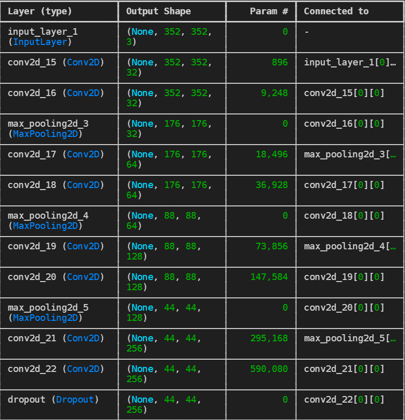 | 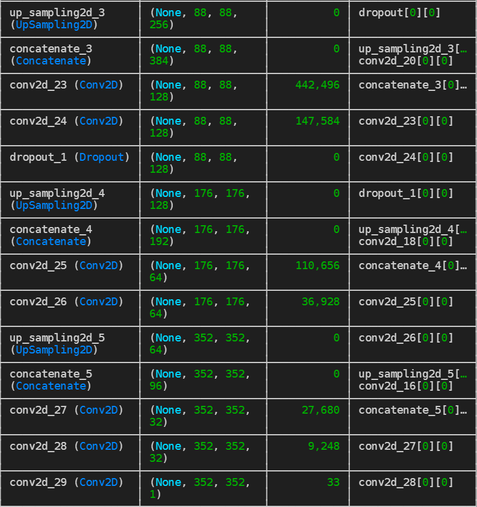 |

- **Data split** — the original and generated synthetic data were split
  into three sets:
  1. **Train data** — 585 samples, used to train the model.
  2. **Validation data** — 100 samples, used to monitor model performance
     during training and prevent overfitting.
  3. **Test data** — 35 samples, used for final evaluation of model
     performance.
- **U-Net model** — chosen as the standard architecture for the image
  segmentation task. With its encoder-decoder layers, it can capture
  plaques' spatial features at different scales and produce the final
  mask with high accuracy.
- **Training setup** — **Dice loss** was used as the criterion for
  measuring overlap between predicted and ground-truth masks, chosen
  because of the imbalanced nature of the data (the number of plaque
  pixels is small relative to background pixels). The **Adam** optimizer
  was used to update the weights.

### 7.4 Reviewing Model Results

The model was trained for 30 epochs, then evaluated on several criteria.
The exact per-epoch numbers survived as `results/metrics_log.csv` (saved
identically under two filenames) and match the report's own training
curves almost exactly, so the **validation numbers below are read from
that CSV** (final epoch, i.e. epoch 30) rather than transcribed from the
PDF's text, which uses Persian-script numerals that are easy to
mis-transcribe:

- **Dice coefficient** — a statistical measure of spatial similarity
  between two sets. In segmentation, it measures the overlap between the
  predicted mask and the ground truth:

  `Dice(P, G) = 2·|P ∩ G| / (|P| + |G|)`

  The value ranges from 0 (no overlap) to 1 (complete overlap). The model
  reached a Dice coefficient of **78.2%** on the validation set, indicating
  high overlap and strong performance at identifying plaques — the model
  correctly identified a large share of the real plaques and estimated
  their boundaries with good precision.
- **Accuracy** — the ratio of correctly classified pixels (plaque pixels
  correctly identified as plaque, background pixels correctly identified
  as background) to total pixels. The model reached **99.6%** accuracy on
  the validation set. This very high value is expected given the
  imbalanced nature of the data (far fewer plaque pixels than background
  pixels), but it still reflects strong performance on classifying
  background pixels.
- **Recall (sensitivity)** — the model's ability to find all the real
  plaques (true positive pixels). Especially important in medical
  diagnosis, where missing a plaque can lead to an incorrect diagnosis.
  The model reached **78.8%** recall on the validation set.
- **Precision** — the model reached **77.7%** precision, meaning about
  78% of the pixels the model classified as plaque were actually plaque —
  relatively few false positives.
- **IoU (Jaccard score)** — similar to the Dice coefficient:

  `IoU(P, G) = |P ∩ G| / |P ∪ G|`

  The model reached an IoU of **64.3%**. Lower than the Dice coefficient,
  which is expected (IoU ≤ Dice for the same prediction), but still
  indicates good performance at precisely segmenting the plaques.

| Dice | Accuracy | Recall | Precision | IoU |
|---|---|---|---|---|
| 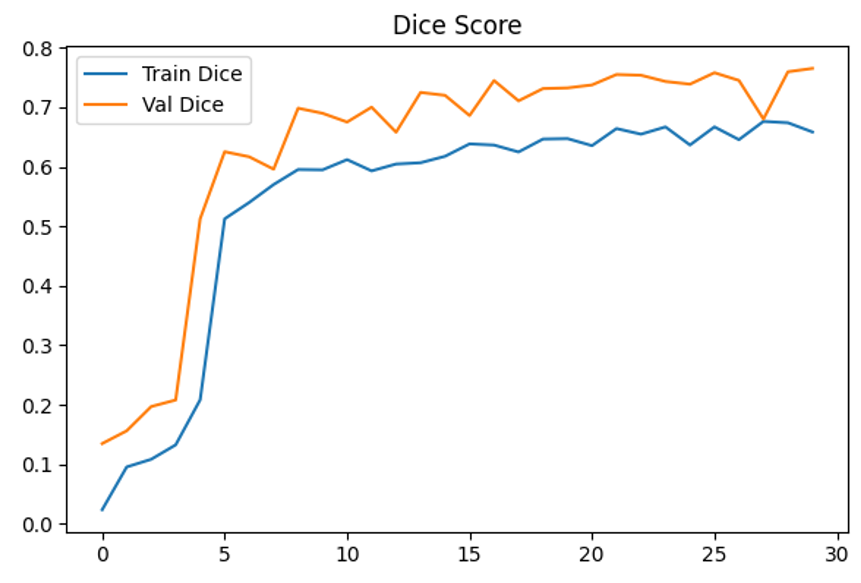 | 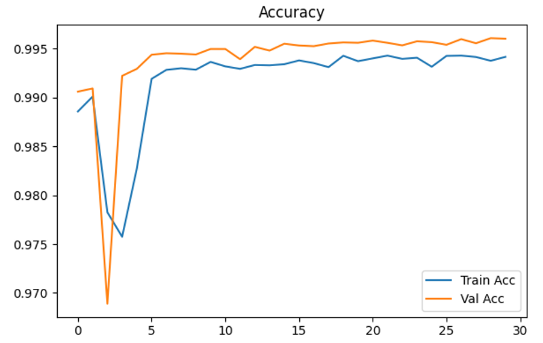 | 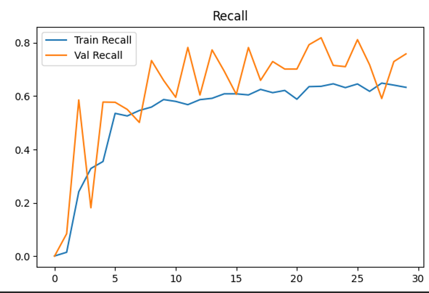 | 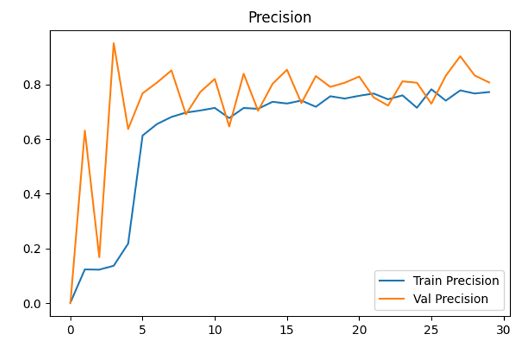 | 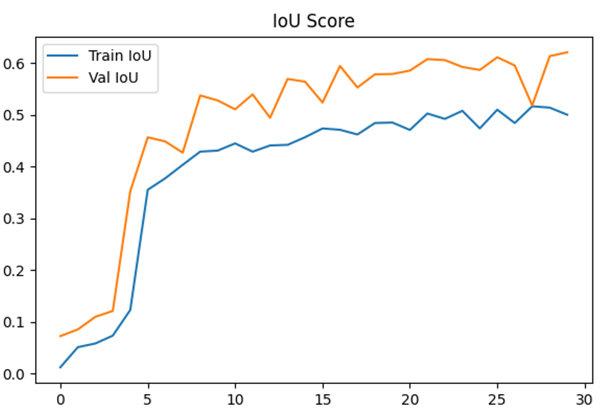 |

### 7.5 Model Results on Test Data

The report also gives a separate held-out test-set table (35 samples) —
reproduced here with full confidence since these are plain decimal digits
in the PDF, not numerals that needed un-reversing:

| Metric | Value |
|---|---|
| Test Loss | 0.2960 |
| Test Dice Score | 0.7040 |
| Test IoU Score | 0.5432 |
| Test Precision | 0.3775 |
| Test Recall | 0.3466 |
| Test Accuracy | 0.9985 |

Test precision/recall are notably lower than validation — worth keeping in
mind given the test set is only 35 images. Two example predictions from
the report:

| Example 1 | Example 2 |
|---|---|
| 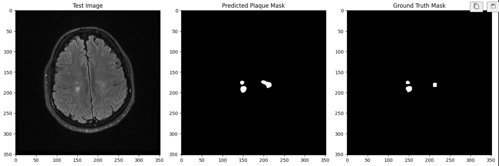 | 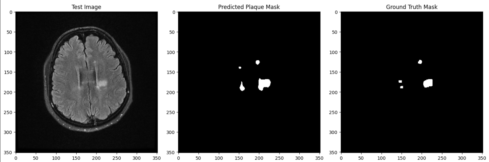 |

## 8. Conclusion

In this project, using techniques such as Bezier curves, scaling, and
rotation, together with realistic compositing of the generated plaques
with the background, we succeeded in generating new data (roughly 1500 new
samples) that not only addresses the data-scarcity problem in the medical
field, but also notably increased the diversity of the data. Using the
U-Net model showed acceptable results across various metrics, indicating
this is a good model for medical problems including segmentation.

## Project Structure

```
docs/                        full report (PDF) + illustrative figures (mostly extracted from the PDF itself)
01_brain_extraction/
  preprocessing/              classical threshold-based masking + manual mask editor GUI
  pytorch/                    U-Net brain extraction (PyTorch)
02_plaque_analysis/           plaque statistics, centroid heatmap, GLCM texture features
03_synthetic_data_generation/ the core synthetic-plaque pipeline
04_model_training/
  keras_architecture_search/  the DeepLabV3+ → U-Net model search from report section 9 (the model behind the report's results)
  train_baseline.ipynb, train_with_augmentation.ipynb — a separate baseline-vs-augmented comparison, different architecture
dataset_tools/                small housekeeping scripts (renaming, cropping, filtering pairs)
results/                      training metric logs (CSV)
```

Each subfolder has its own short README with implementation detail that
doesn't belong at the project level.

## Setup

```bash
pip install -r requirements.txt
```

The PyTorch and TensorFlow/Keras pieces are independent — you only need
the dependency matching whichever brain-extraction implementation you use.

## Data

This repo intentionally does **not** include the MRI dataset, intermediate
mask folders, generated synthetic images, or trained model weights
(`.h5` / `.pth`) — they're either patient data, derived from patient data,
or too large for a git repo (100+ MB each). The illustrative images under
`docs/assets/` are pre-made, de-identified result figures, not raw scans.


